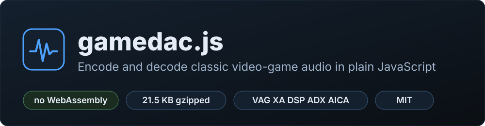
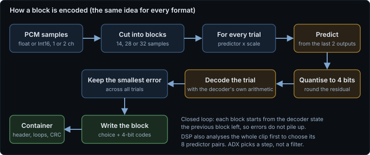
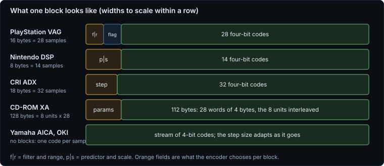
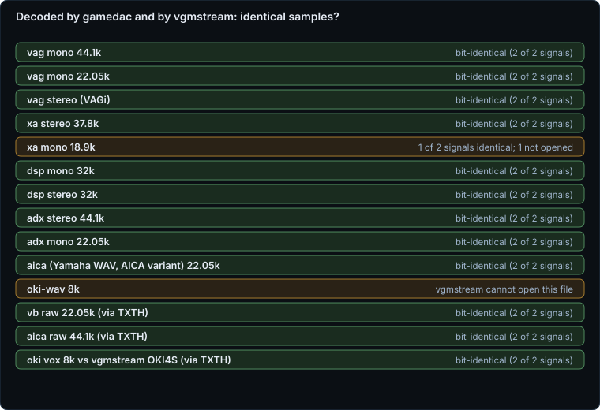
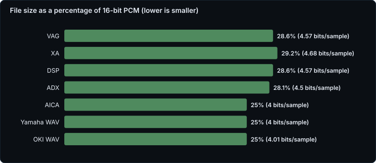
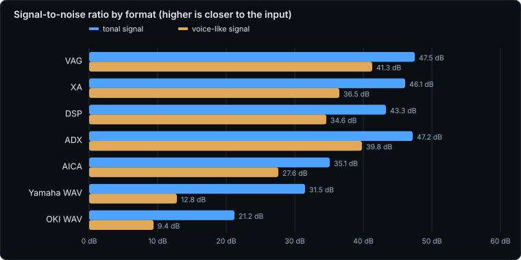
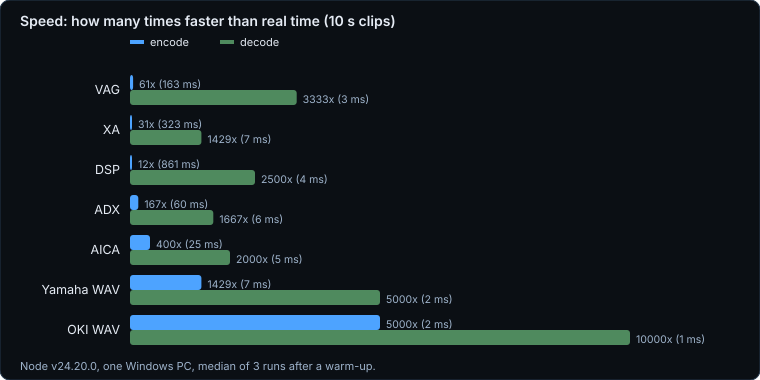

<p align="center"></p>

<p align="center">
  <a href="LICENSE"></a>
  
  
  
  <a href="https://dialersapps.pages.dev/lab/notes/gamedac.html"></a>
</p>

**gamedac.js** reads **and writes** the audio formats of classic game consoles in plain JavaScript: **PlayStation** VAG, VB and CD-XA, **Nintendo GameCube / Wii** DSP, **CRI ADX**, **Dreamcast** AICA (Yamaha) ADPCM and OKI ADPCM. Every format has an encoder and a decoder. No WebAssembly, no dependencies, no DOM: it runs in a page, in a Web Worker or in Node.

> [!NOTE]
> **How far to trust it.** Every format's decoded output was compared with [vgmstream](https://github.com/vgmstream/vgmstream) (compiled to WebAssembly, used as an independent decoder) and is **bit-identical** for every format we could open in it; the comparison is in [`docs/crosscheck.json`](docs/crosscheck.json) and found six real bugs along the way (see [What the vgmstream check found](#what-the-vgmstream-check-found)). We have **not** tested on real hardware, in an emulator, in a game, or with the console makers' own tools. See [Known limits](#known-limits).

**Contents:** [Why](#why) · [Quick start](#use) · [API](#api) · [How it works](#how-it-works) · [vgmstream check](#what-the-vgmstream-check-found) · [Numbers](#numbers-what-we-measured) · [Tests](#tests) · [Limits](#known-limits) · [Licence](#licence)

## Why

Game audio is stored in dozens of small, odd formats, and the tools that handle them are mostly native programs: vgmstream (C, decode only), VGAudio (C#), psxavenc (C), FFmpeg. We wanted to read and write these formats from a web page, with one file and nothing to load, so that people can convert, preview and create game audio in a browser.

When we searched npm and GitHub (October 2026) for JavaScript implementations we found **decoders only**: small packages for PlayStation ADPCM and Nintendo DSP-ADPCM (`@tootallnate/ps-adpcm`, `@tootallnate/dsp-adpcm`, both from June 2026 and without documentation), a BRSTM file decoder (`brstm`) and an HCA decoder (`hca.js`). We found **no JavaScript encoder** for any of these formats, and nothing for ADX, CD-XA, Dreamcast AICA or OKI. "We found none" describes our search, not a guarantee.

| Format | Used by | Encode | Decode | Identical to vgmstream |
|---|---|---|---|---|
| **VAG** `.vag` (VAGp mono, VAGi interleaved), **VB** `.vb` raw | PlayStation, PS2 | yes | yes | yes (all three) |
| **XA** `.xa` | PlayStation CD streams | yes (4-bit) | yes (4 and 8-bit) | yes (4-bit; one mono voice-like file would not open in vgmstream) |
| **DSP** `.dsp` | GameCube, Wii | yes, with its own predictor analysis | yes | yes (mono and stereo) |
| **ADX** `.adx` | Dreamcast, PS2, arcade, many others | yes | yes | yes |
| **AICA** `.aica` raw and Yamaha WAV | Dreamcast and Yamaha chips | yes | yes | yes (AICA variant) |
| **OKI / VOX** `.vox` raw and OKI WAV | arcade boards, MSM6258 style | yes | yes | yes against vgmstream's OKI4S (raw); the WAV form is not opened by vgmstream |

## Use

```html
<script src="gamedac.js"></script>
<script>
  // Encode: channels is Float32Array[] (or Int16Array[]), one per channel
  const dsp = gamedac.encode({ format: "dsp", channels: [left, right], sampleRate: 32000 });   // a Uint8Array: a stereo .dsp file

  // Decode: the format is recognised from the bytes
  const song = gamedac.decode(bytesOfAnyGameFile);       // { format, sampleRate, channels, channelData, loop? }
  const wav = gamedac.toWav(song);                       // a plain 16-bit WAV
</script>
```

ES module (`gamedac.mjs`, same code): `import gamedac from "./gamedac.mjs";` or `import { encode, decode } from "./gamedac.mjs";`. Node / CommonJS: `const gamedac = require("./gamedac.js");`

Try it without writing code: serve this folder with any static server and open [`demo.html`](demo.html). It encodes your own audio into any format and plays the decoded result, and it opens `.vag`, `.xa`, `.dsp`, `.adx` and friends so you can play them or save them as WAV. Nothing is uploaded.

## API

| | |
|---|---|
| `gamedac.encode(options)` | Returns a `Uint8Array` (a file, or for `dsp` with `split: true` an array of one file per channel). |
| `gamedac.decode(bytes, options)` | Auto-detects the format. Returns `{ format, sampleRate, channels, channelData: Float32Array[], loop? }` plus format extras (XA also returns `bits` and `streams`). Headerless data needs `{ format }`. |
| `gamedac.detect(bytes)` | The format id from the content, or `null`. VB, AICA and VOX have no header and cannot be detected. |
| `gamedac.toWav(decoded)` | A plain 16-bit PCM WAV of a decode result (loop points are not written). |
| `gamedac.formats` | The list of formats with their ids, extensions and platforms. |

### Encode options

Common: `format` (`vag`, `vb`, `xa`, `dsp`, `adx`, `aica`, `yamaha-wav`, `vox`, `oki-wav`; `vagi` is an alias for stereo `vag`), `channels` (typed arrays, all the same length) **or** `interleaved` + `numChannels`, `sampleRate`, optionally `outChannels` (1 or 2, to remix).

| Format | Options |
|---|---|
| `vag` | `interleave: true` writes a stereo VAGi file (`interleaveSize` bytes per chunk, default 16); without it a stereo input is mixed down to mono. `loop: true` or `{ start, end }` in samples; `name` (16 characters). |
| `vb` | Headerless blocks; same options as `vag`. |
| `xa` | `xaRate`: 37800 (default) or 18900; the input is resampled to it. `bits: 4` (default) or `8`; `file`, `channel`, `startSector`, `edc` (default on). |
| `dsp` | `loopStart`, `loopEnd` in samples; `split: true` for one standalone mono file per channel. Stereo files use the two-header layout vgmstream reads. |
| `adx` | `cutoff` (default 500 Hz), `version` (3 or 4, default 4), `loopStart`, `loopEnd`. Up to 8 channels. |
| `aica`, `yamaha-wav` | `variant`: `"aica"` (Dreamcast, leaky predictor; the default for `aica`) or `"ym"` (plain Yamaha, as FFmpeg's `adpcm_yamaha`; the default for `yamaha-wav`), `codecRate`, `nibbleOrder`. |
| `vox`, `oki-wav` | `codecRate` (default 8000, `"native"` keeps the input rate; `variant: "6k"` for 6 kHz). |

## How it works

All of these formats are small adaptive-predictor codecs: audio is cut into little blocks, each block says which predictor and scale to use, and every sample after that is a 4-bit correction to the prediction. The encoders search the choices **in a closed loop**: for every block they try each predictor and scale, run the decoder's own arithmetic on the trial, and keep the one with the smallest error, starting each block from the state the previous block really produced.

<p align="center"></p>

Where the formats differ is the unit they work on:

<p align="center"></p>

Two of the encoders do more than the block search. **DSP** first analyses the whole clip (autocorrelation per frame, Levinson-Durbin, then k-means style clustering into the 8 predictor pairs the format allows); **ADX** picks a step size per block instead of a filter. **XA** resamples to its fixed 37.8 or 18.9 kHz, and **OKI** to its 8 kHz, unless you ask otherwise.

## What the vgmstream check found

We encoded test signals with gamedac, then decoded the same bytes with gamedac and with vgmstream and compared the samples ([`tools/crosscheck-vgmstream.mjs`](tools/crosscheck-vgmstream.mjs), results in [`docs/crosscheck.json`](docs/crosscheck.json)). The first run disagreed on most formats. It found six problems, all now fixed, and each one is something an encoder that is only tested against itself would never notice:

1. **PlayStation ADPCM rounding and clamping.** Our decoder rounded the prediction and clamped its running state; vgmstream shifts without rounding and clamps only the output. Close on quiet audio, far apart on loud audio. We now match vgmstream exactly (the nocash notes add `+32`, a difference under one LSB per sample).
2. **CD-XA rounding.** Same family: now `(x + 32) >> 6`, as vgmstream does.
3. **GameCube DSP stereo.** Our stereo file wrote a channel count of 2 in the header; vgmstream decoded it as noise. The layout it reads has the channel field set to 1, two headers and 8-byte interleave. Fixed, and the decoder accepts both.
4. **VAGi stereo.** Needed audio at offset `0x800`, and a size field that counts one channel. Without both, vgmstream refused or mis-decoded the file.
5. **Dreamcast AICA.** The real AICA predictor leaks by 254/256 every sample; our plain Yamaha decoder did not, so every AICA file differed. Added as the `aica` variant (and the default for `aica`).
6. **OKI.** vgmstream computes in a 16-bit domain and keeps the fraction bits; our 12-bit version rounded them away and drifted. Fixed.

<p align="center"></p>

What this does **not** show: vgmstream is a decoder that agrees with the games and tools that exist, not hardware itself, and two things were not opened by it (one mono voice-like XA file, and the OKI-in-WAV container).

## Numbers (what we measured)

Measured in Node 24 on one Windows PC with **synthetic, seeded signals** (decaying chord tones and a voice-like harmonic signal; see [`tools/measure.mjs`](tools/measure.mjs)), reproducible with `npm run measure`. No real game assets were used, and there is no listening test.

<p align="center"></p>

<p align="center"></p>

<p align="center"></p>

- **Size**: every format is a fixed-rate 4-bit codec, so files are 25 to 29% of 16-bit PCM (4.0 to 4.7 bits per sample including headers).
- **Signal-to-noise ratio** (decoded against the input): 43 to 48 dB on the tonal signal and 35 to 41 dB on the voice-like one for VAG, XA, DSP and ADX; AICA 35 and 28 dB; plain Yamaha 31 and 13 dB; OKI 21 and 9 dB. The simple Yamaha and OKI quantisers lose a lot on voice-like material, as 4-bit ADPCM at low rates does.
- **Speed**: decoding 10 s of audio takes 1 to 7 ms; encoding takes 2 ms (OKI) to 0.86 s (DSP, which analyses the whole clip first).
- **Size of the code**: `gamedac.js` is 76.9 KB with licence header and comments, about 57.6 KB with comments and whitespace stripped (a crude strip, not a real minifier), and 21.5 KB gzipped as shipped (14.9 KB stripped and gzipped).

## Tests

Serve this folder with any static server and open [`test.html`](test.html), or run `npm test` (Node 18 or later). Both run the same 94 checks on seeded synthetic signals: a round trip for every format (the right channel count and rate, content detection, a signal-to-noise floor, a stereo channel staying separate); determinism; interleaved and `Int16Array` input giving the same bytes; mono down-mix; split DSP files; `toWav`; loop points surviving a round trip for VAG, DSP and ADX; the file layouts other tools depend on (VAGi at `0x800` with a per-channel size, the stereo DSP header, the AICA leak); tiny, silent and out-of-range input; the errors for bad options and bad files; and **regression vectors**: hashes of the encoded bytes and decoded samples of one fixed clip per format, which were bit-identical to vgmstream when recorded. `test.html` also checks the ES module against the script build. All 94 passed at the time of writing in Node 24 and Chromium.

## Known limits

- **Not tested on hardware, in an emulator or in a game**, and not compared with Sony's, Nintendo's or CRI's own tools. The reference was vgmstream's decoder; where it differs from real hardware (for example the `+32` rounding in PlayStation ADPCM), we follow vgmstream.
- **The encoders are plain.** They search the block choices in a closed loop, but there is no noise shaping, no look-ahead, no tuned loop-point handling. We have not compared their quality with other encoders such as VGAudio or psxavenc.
- **Two things vgmstream would not open**: one mono voice-like XA file (the same bytes decode fine here, and a tonal mono XA file is bit-identical) and the OKI-in-WAV container (the raw OKI stream is checked). The plain Yamaha dialect (`ym`) has no independent check, because vgmstream reads that WAV tag as AICA.
- **Formats not covered**: no ADX encryption, AHX or HCA, no more than 2 channels for DSP and XA, no loop points for XA, AICA and OKI, no BRSTM/BCSTM/IDSP containers, no SNES BRR.
- **Synthetic test signals only**, in Node and Chromium.
- **Names and formats belong to their owners.** PlayStation, Nintendo, GameCube, Wii, Dreamcast and CRI ADX are trademarks or formats of their respective owners; this project is not affiliated with or endorsed by them, and we have made no patent or legal review. Use it on audio you have the right to use.

## Where the code comes from

gamedac.js was written by Dialer's Apps from public format documentation (the nocash PSX-SPX notes, the published GameCube DSP header layout, the descriptions of ADX, Yamaha and OKI ADPCM). It contains no code copied from another project. vgmstream (ISC licence) was used as a black-box reference decoder to check our output, not as a source of code.

## Licence

MIT, see [`LICENSE`](LICENSE). Copyright (c) 2026 Dialer's Apps.

Made by [Dialer's Apps](https://dialersapps.pages.dev/). Read the story behind it in the
[blog post](https://dialersapps.pages.dev/lab/notes/gamedac.html).